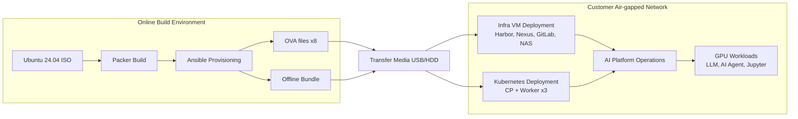
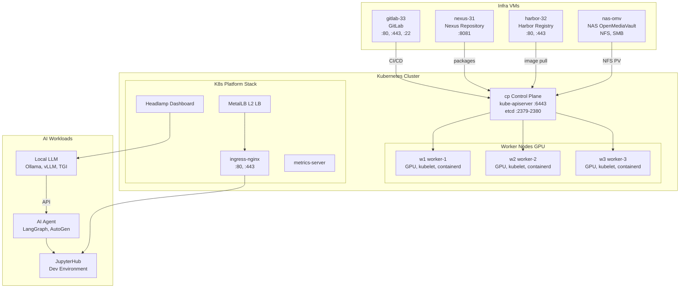
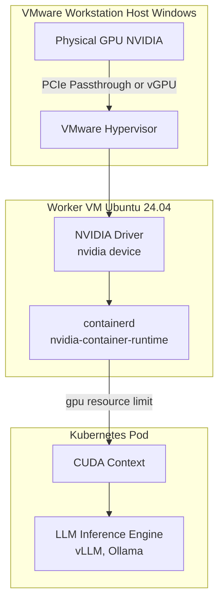
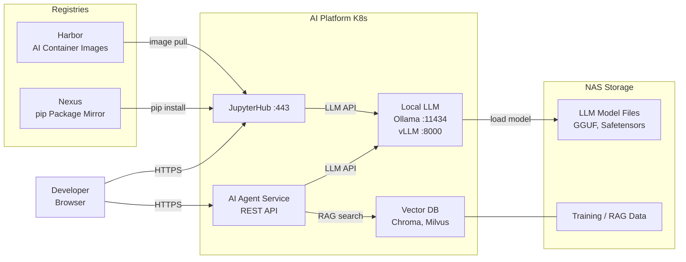
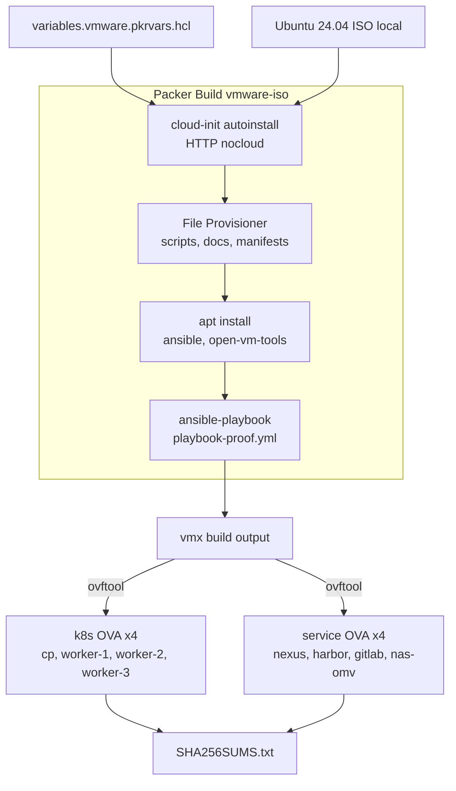
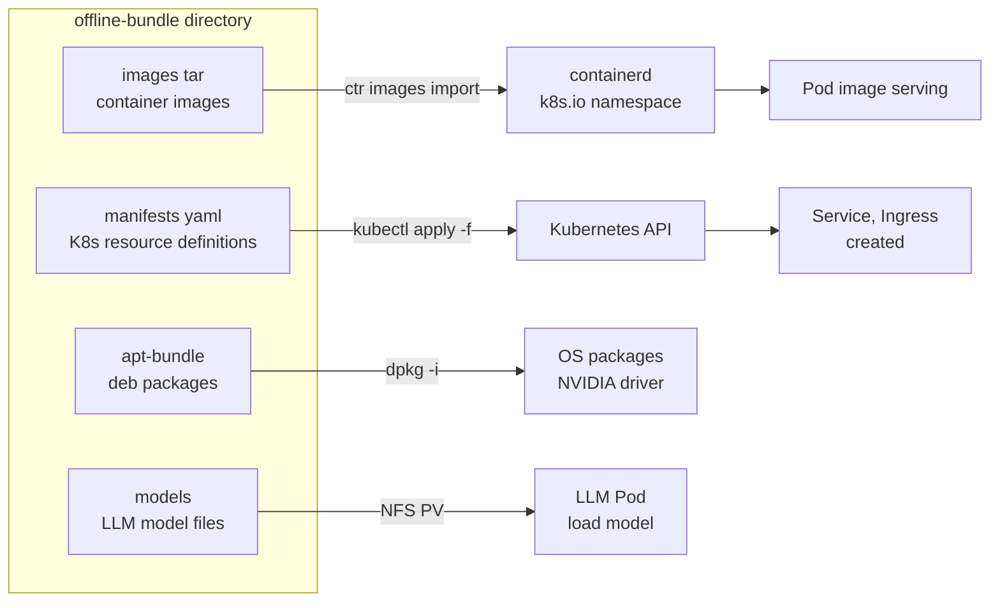

# k8s-jupyter — Air-gap AI Agent Platform (VMware OVA)

🌐 **English** | [中文](docs/i18n/README.zh.md) | [日本語](docs/i18n/README.ja.md) | [한국어](readme-kr.md)

An automation repository for building a **GPU-based Local LLM + AI Agent development/operations platform** by porting VMs as VMware OVAs into a customer's **air-gapped** environment.

---

## Tech Stack

### Platform / Infrastructure

- `VMware OVA`
- `Ubuntu 24.04`
- `Kubernetes`
- `containerd`
- `NVIDIA GPU / CUDA`
- `Harbor`, `Nexus`, `GitLab`, `NAS (OpenMediaVault)`

### AI / Development Stack

- `Ollama`, `vLLM`, `TGI`
- `JupyterHub`
- `LangGraph`, `AutoGen`
- `Chroma`, `Milvus`

### Local Development Toolchain

- `Visual Studio Code`
- Local LLM inference via `Ollama`
- Local coding agent combining `Codex CLI` + `Ollama (--oss)`
- Local coding agent combining `Claude Code` + `Ollama`
- `Node.js / npm`, `Git for Windows`
- Optional: a custom local agent sidebar as a `VSCode Extension`

### Offline (Air-gap) Development Principles

- Even without internet access, `Ollama` with pre-downloaded models can write code, refactor, explain code, and draft tests
- `Codex CLI` and `Claude Code` can be configured to read/modify files and run commands against the local working directory
- Web search, up-to-date documentation lookup, installing new packages, and remote Git integration are limited without internet access or an internal mirror
- Before bringing assets into the air-gapped network, it is recommended to pre-bundle `models`, `pip/npm/apt dependencies`, `documentation`, and `example code`
- For agent work on large codebases, a larger context window is advantageous, so raising the `Ollama` context length is recommended

### Windows Local Development Helper Script

- [setup-windows-ollama-dev.ps1](setup-windows-ollama-dev.ps1)
- Purpose: automates `Codex CLI`, `Claude Code`, local model pulls, and VSCode integration checks in a `Windows + VSCode + Ollama + local GPU` environment

### VS Code Local Agent Extension

- [tools/vscode-local-agent/README.md](tools/vscode-local-agent/README.md)
- Purpose: adds a `Local Agent` icon to the VS Code Activity Bar, providing a sidebar chat panel that calls Windows Ollama (`http://172.29.32.1:11434`) from WSL
- Run: from the root workspace, press `F5` or use `Run and Debug > Run Local Ollama Agent Extension`

---

## Architecture Diagrams

### 1. Overall Delivery Pipeline



---

### 2. Customer Air-gapped VM Layout (8 VMs)



---

### 3. GPU Passthrough Architecture



---

### 4. AI Agent Development Workflow



---

### 5. OVA Build Details (Packer)



---

### 6. Offline Bundle Import Flow



---

## VM Inventory

| VM | Role | Key Services | Ports |
| ---- | ------ | ---------- | ------ |
| `cp` | Kubernetes Control Plane | kube-apiserver, etcd, scheduler | 6443, 2379-2380 |
| `w1` | Kubernetes Worker + GPU | kubelet, containerd, NVIDIA runtime | 10250 |
| `w2` | Kubernetes Worker + GPU | kubelet, containerd, NVIDIA runtime | 10250 |
| `w3` | Kubernetes Worker + GPU | kubelet, containerd, NVIDIA runtime | 10250 |
| `nexus-31` | Nexus Repository | apt mirror, pip mirror, helm chart | 8081 |
| `harbor-32` | Harbor Registry | Container image registry | 80, 443 |
| `nas-omv` | NAS (OpenMediaVault) | NFS, SMB shared storage | 2049(NFS) |
| `gitlab-33` | GitLab | Source control, CI/CD | 80, 443, 22 |

---

## Key Directories

```text
.
├── packer/         # VM/OVA image build definitions (vmware-iso)
├── scripts/        # VM networking, install, import, verification automation
└── docs/           # Phase-by-phase operations documentation
```

---

## Quick Start

```bash
# Phase 1: Build OVA (online environment)
bash scripts/phase1_build_ova_assets.sh all

# Phase 2: Prepare air-gap operations after booting the OVA
bash scripts/phase2_operate_airgap_cluster.sh all

# Phase 3: Install in the air-gapped network
bash scripts/phase3_install_from_completed_ova.sh full

# Check status
bash scripts/status_k8s.sh
bash scripts/check_vm_airgap_status.sh
```

---

## Installation Procedure (OVA-based)

### 1. Prerequisites

- 8 OVA files (cp, w1~3, nexus, harbor, gitlab, nas-omv)
- Offline bundle (`images/*.tar`, `manifests/`, `apt-bundle/`, `models/`)

### 2. Basic VM Setup (each node)

```bash
sudo bash scripts/set_static_ip.sh --ip <IP> --prefix 24 --gateway <GW>
sudo bash scripts/set_hostname_hosts.sh --hostname <HOSTNAME> --entry "<IP> <HOSTNAME>"
```

### 3. Import Offline Bundle

```bash
bash scripts/import_offline_bundle.sh --bundle-dir /opt/k8s-data-platform/offline-bundle --apply
```

### 4. Post-install Checks

```bash
bash scripts/status_k8s.sh
bash scripts/check_vm_airgap_status.sh
kubectl get nodes -o wide
kubectl get pods -A
```

### 5. Rebuild OVA (if needed)

```bash
bash ovabuild.sh --vars-file packer/variables.vmware.auto.pkrvars.hcl --dist-dir C:/ffmpeg
```

---

## Troubleshooting

### Kubernetes Basic Status

```bash
bash scripts/status_k8s.sh
kubectl get nodes -o wide && kubectl get pods -A
```

### containerd / kubelet Issues

```bash
sudo systemctl restart containerd kubelet
sudo systemctl status containerd kubelet --no-pager
```

### Offline Image Import Failure

```bash
bash scripts/import_offline_bundle.sh --bundle-dir /opt/k8s-data-platform/offline-bundle --runtime-only
```

### VM Network Issues

```bash
ip a && ip route && cat /etc/hosts
sudo bash scripts/set_static_ip.sh --ip <IP> --prefix 24 --gateway <GW>
```

---

## Documentation Map

| Document | Content |
| ------ | ------ |
| `docs/phase-1-build-ova.md` | OVA build (online) |
| `docs/phase-2-ova-solution-ops.md` | Operations prep after booting OVA |
| `docs/phase-3-install-airgap-from-ova.md` | Air-gapped installation |
| `docs/checklist.md` | Build/deploy/rehearsal checklist |
| `PORTS.md` | Port list |
| `CHANGELOG.md` | Change history |
| `docs/docs-map.md` | Full documentation index |
