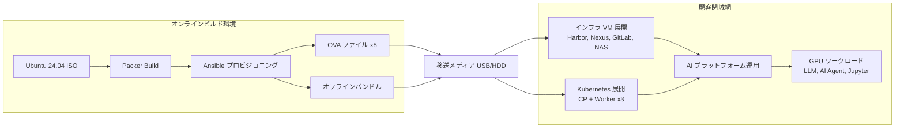
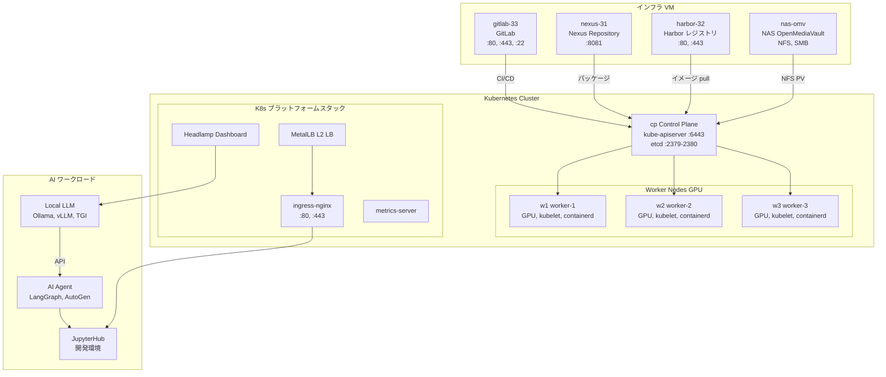
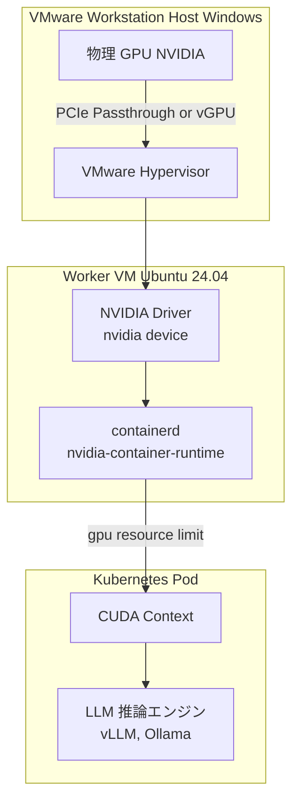
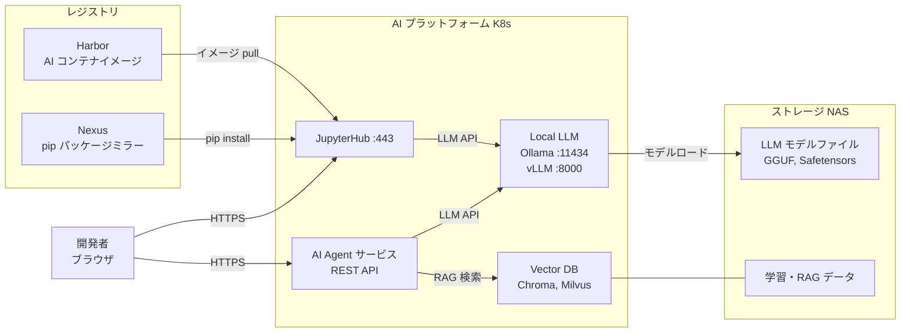
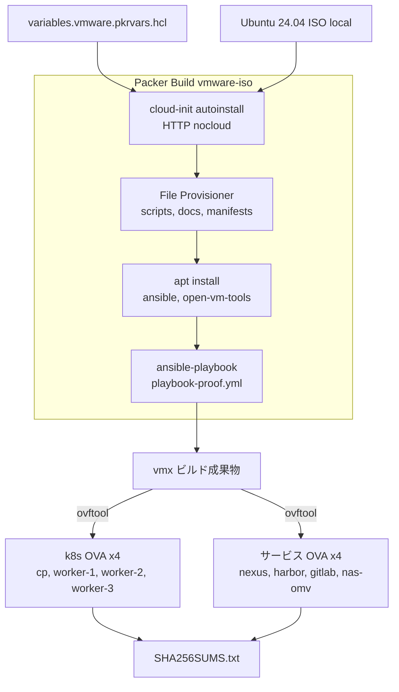
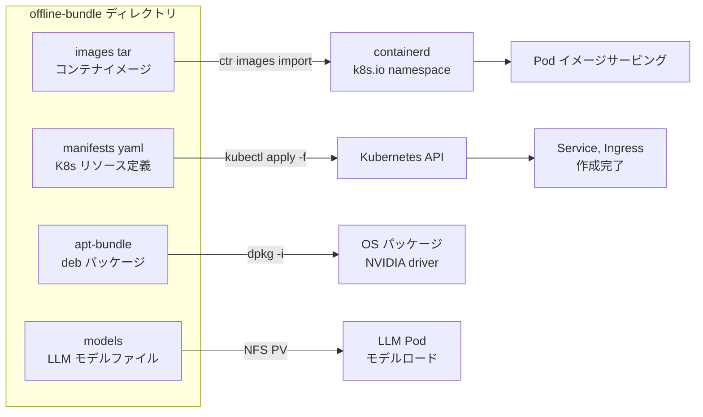

# k8s-jupyter — エアギャップ AI エージェントプラットフォーム（VMware OVA）

🌐 [English](../../README.md) | [中文](README.zh.md) | **日本語** | [한국어](../../readme-kr.md)

顧客の**閉域網（air-gap）**環境に VMware OVA として VM を移送し、
**GPU ベースのローカル LLM + AI エージェント開発・運用プラットフォーム**を構築する自動化リポジトリです。

---

## 技術スタック

### プラットフォーム／インフラ

- `VMware OVA`
- `Ubuntu 24.04`
- `Kubernetes`
- `containerd`
- `NVIDIA GPU / CUDA`
- `Harbor`, `Nexus`, `GitLab`, `NAS (OpenMediaVault)`

### AI／開発スタック

- `Ollama`, `vLLM`, `TGI`
- `JupyterHub`
- `LangGraph`, `AutoGen`
- `Chroma`, `Milvus`

### ローカル開発ツールチェーン

- `Visual Studio Code`
- `Ollama` によるローカル LLM 推論
- `Codex CLI` + `Ollama (--oss)` の組み合わせによるローカルコーディングエージェント
- `Claude Code` + `Ollama` の組み合わせによるローカルコーディングエージェント
- `Node.js / npm`, `Git for Windows`
- オプション：`VSCode Extension` 形式のカスタムローカルエージェントサイドバー

### オフライン（air-gap）開発の原則

- インターネットがなくても、事前にダウンロードした `Ollama` モデルでコード作成・リファクタリング・説明・テスト草案の生成が可能
- `Codex CLI` と `Claude Code` はローカル作業ディレクトリを基準にファイルの読み書きやコマンド実行のワークフローを構成可能
- Web 検索、最新ドキュメント参照、新規パッケージのインストール、リモート Git 連携はインターネットまたは社内ミラーがないと制限される
- 閉域網への持ち込み前に `モデル`、`pip/npm/apt 依存関係`、`ドキュメント`、`サンプルコード` を事前にバンドルすることを推奨
- 大規模コードベース向けのエージェント作業には大きなコンテキストが有利なため、`Ollama` のコンテキスト長を拡張する構成を推奨

### Windows ローカル開発補助スクリプト

- [setup-windows-ollama-dev.ps1](/home/ubuntu/k8s-jupyter/setup-windows-ollama-dev.ps1)
- 目的：`Windows + VSCode + Ollama + ローカル GPU` 環境で `Codex CLI`、`Claude Code`、ローカルモデルの pull、VSCode 連携チェックを自動化

### VS Code ローカルエージェント拡張機能

- [tools/vscode-local-agent/README.md](/home/ubuntu/k8s-jupyter/tools/vscode-local-agent/README.md)
- 目的：VS Code の左側 `Activity Bar` に `Local Agent` アイコンを追加し、WSL から Windows Ollama（`http://172.29.32.1:11434`）を呼び出すサイドバーチャットパネルを提供
- 実行：ルートワークスペースで `F5`、または `Run and Debug > Run Local Ollama Agent Extension`

---

## アーキテクチャ図

### 1. 全体デリバリーパイプライン



---

### 2. 顧客閉域網 VM 構成（8台）



---

### 3. GPU パススルー構造



---

### 4. AI エージェント開発ワークフロー



---

### 5. OVA ビルド詳細（Packer）



---

### 6. オフラインバンドル持ち込みフロー



---

## VM インベントリ

| VM | 役割 | 主なサービス | ポート |
| ---- | ------ | ---------- | ------ |
| `cp` | Kubernetes Control Plane | kube-apiserver, etcd, scheduler | 6443, 2379-2380 |
| `w1` | Kubernetes Worker + GPU | kubelet, containerd, NVIDIA runtime | 10250 |
| `w2` | Kubernetes Worker + GPU | kubelet, containerd, NVIDIA runtime | 10250 |
| `w3` | Kubernetes Worker + GPU | kubelet, containerd, NVIDIA runtime | 10250 |
| `nexus-31` | Nexus Repository | apt mirror, pip mirror, helm chart | 8081 |
| `harbor-32` | Harbor Registry | コンテナイメージレジストリ | 80, 443 |
| `nas-omv` | NAS (OpenMediaVault) | NFS, SMB 共有ストレージ | 2049(NFS) |
| `gitlab-33` | GitLab | ソースコード管理, CI/CD | 80, 443, 22 |

---

## 主要ディレクトリ

```text
.
├── packer/         # VM/OVA イメージビルド定義 (vmware-iso)
├── scripts/        # VM ネットワーク・インストール・持ち込み・検証の自動化
└── docs/           # フェーズ別運用ドキュメント
```

---

## クイックスタート

```bash
# Phase 1: OVA ビルド（オンライン環境）
bash scripts/phase1_build_ova_assets.sh all

# Phase 2: OVA 起動後の air-gap 運用準備
bash scripts/phase2_operate_airgap_cluster.sh all

# Phase 3: 閉域網インストール
bash scripts/phase3_install_from_completed_ova.sh full

# 状態確認
bash scripts/status_k8s.sh
bash scripts/check_vm_airgap_status.sh
```

---

## インストール手順（OVA ベース）

### 1. 準備物

- OVA ファイル 8個（cp, w1~3, nexus, harbor, gitlab, nas-omv）
- オフラインバンドル（`images/*.tar`, `manifests/`, `apt-bundle/`, `models/`）

### 2. VM 基本設定（各ノード）

```bash
sudo bash scripts/set_static_ip.sh --ip <IP> --prefix 24 --gateway <GW>
sudo bash scripts/set_hostname_hosts.sh --hostname <HOSTNAME> --entry "<IP> <HOSTNAME>"
```

### 3. オフラインバンドルの持ち込み

```bash
bash scripts/import_offline_bundle.sh --bundle-dir /opt/k8s-data-platform/offline-bundle --apply
```

### 4. インストール後の点検

```bash
bash scripts/status_k8s.sh
bash scripts/check_vm_airgap_status.sh
kubectl get nodes -o wide
kubectl get pods -A
```

### 5. OVA 再生成（必要な場合）

```bash
bash ovabuild.sh --vars-file packer/variables.vmware.auto.pkrvars.hcl --dist-dir C:/ffmpeg
```

---

## 障害対応

### Kubernetes 基本状態

```bash
bash scripts/status_k8s.sh
kubectl get nodes -o wide && kubectl get pods -A
```

### containerd / kubelet 異常

```bash
sudo systemctl restart containerd kubelet
sudo systemctl status containerd kubelet --no-pager
```

### オフラインイメージ持ち込み失敗

```bash
bash scripts/import_offline_bundle.sh --bundle-dir /opt/k8s-data-platform/offline-bundle --runtime-only
```

### VM ネットワーク問題

```bash
ip a && ip route && cat /etc/hosts
sudo bash scripts/set_static_ip.sh --ip <IP> --prefix 24 --gateway <GW>
```

---

## ドキュメントマップ

| ドキュメント | 内容 |
| ------ | ------ |
| `docs/phase-1-build-ova.md` | OVA ビルド（オンライン） |
| `docs/phase-2-ova-solution-ops.md` | OVA 起動後の運用準備 |
| `docs/phase-3-install-airgap-from-ova.md` | 閉域網インストール |
| `CHECKLIST.md` | ビルド・デプロイ・リハーサルチェックリスト |
| `PORTS.md` | ポート一覧 |
| `CHANGELOG.md` | 変更履歴 |
