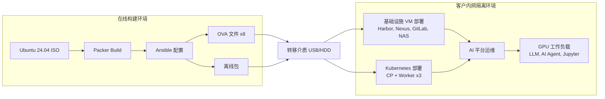
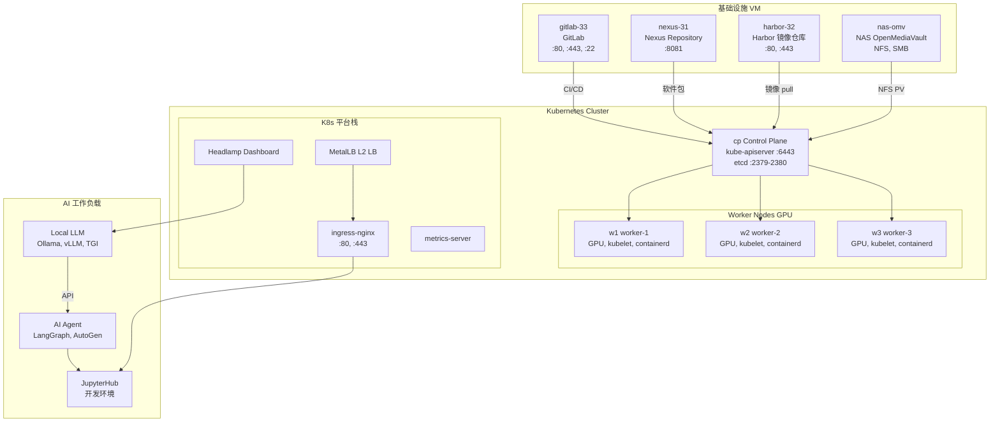
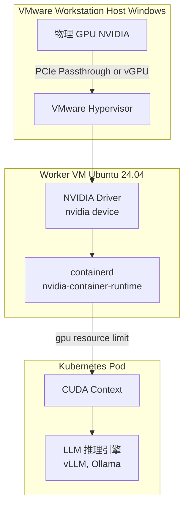
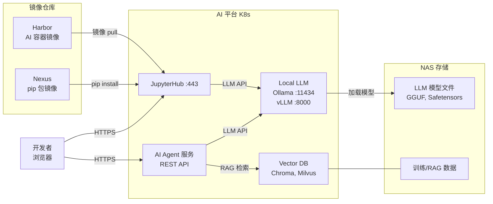
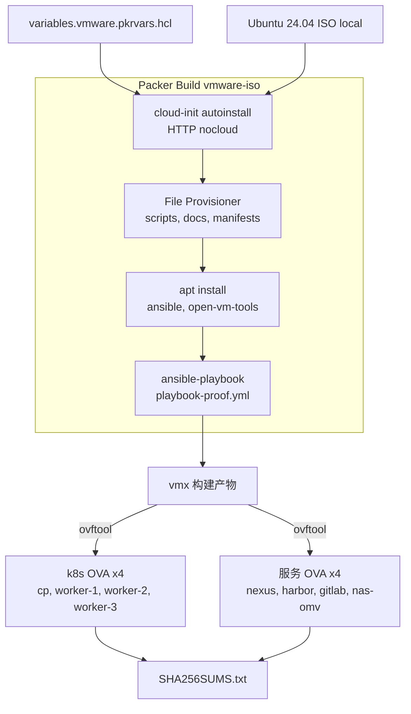
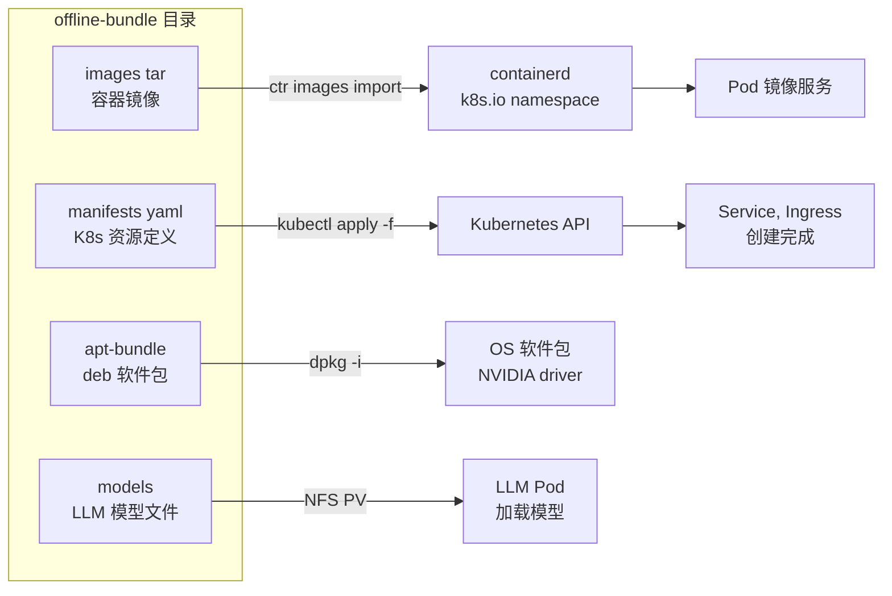

# k8s-jupyter — 内网隔离（Air-gap）AI Agent 平台（VMware OVA）

🌐 [English](README.en.md) | **中文** | [日本語](README.ja.md) | [한국어](../../README.md)

将虚拟机以 VMware OVA 形式移植到客户**内网隔离（air-gap）**环境，
用于构建**基于 GPU 的本地 LLM + AI Agent 开发/运维平台**的自动化仓库。

---

## 技术栈

### 平台/基础设施

- `VMware OVA`
- `Ubuntu 24.04`
- `Kubernetes`
- `containerd`
- `NVIDIA GPU / CUDA`
- `Harbor`, `Nexus`, `GitLab`, `NAS (OpenMediaVault)`

### AI/开发栈

- `Ollama`, `vLLM`, `TGI`
- `JupyterHub`
- `LangGraph`, `AutoGen`
- `Chroma`, `Milvus`

### 本地开发工具链

- `Visual Studio Code`
- 基于 `Ollama` 的本地 LLM 推理
- `Codex CLI` + `Ollama (--oss)` 组合的本地编码代理
- `Claude Code` + `Ollama` 组合的本地编码代理
- `Node.js / npm`, `Git for Windows`
- 可选：以 `VSCode Extension` 形式提供的自定义本地代理侧边栏

### 离线（air-gap）开发原则

- 即使没有互联网，也可以使用预先下载好的 `Ollama` 模型进行代码编写、重构、说明和测试草稿生成
- `Codex CLI` 与 `Claude Code` 可以基于本地工作目录构建文件读写/命令执行工作流
- 网络搜索、最新文档查阅、新包安装、远程 Git 集成在没有互联网或企业内部镜像的情况下会受限
- 建议在带入内网隔离环境前,预先打包好 `模型`、`pip/npm/apt 依赖`、`文档`、`示例代码`
- 面向大型代码库的代理任务更适合较大的上下文,建议提高 `Ollama` 的上下文长度配置

### Windows 本地开发辅助脚本

- [setup-windows-ollama-dev.ps1](/home/ubuntu/k8s-jupyter/setup-windows-ollama-dev.ps1)
- 目的：在 `Windows + VSCode + Ollama + 本地 GPU` 环境中自动化 `Codex CLI`、`Claude Code`、本地模型拉取、VSCode 集成检查

### VS Code 本地代理扩展

- [tools/vscode-local-agent/README.md](/home/ubuntu/k8s-jupyter/tools/vscode-local-agent/README.md)
- 目的：在 VS Code 左侧 `Activity Bar` 添加 `Local Agent` 图标,提供从 WSL 调用 Windows Ollama（`http://172.29.32.1:11434`）的侧边栏聊天面板
- 运行方式：在根工作区按 `F5`，或选择 `Run and Debug > Run Local Ollama Agent Extension`

---

## 架构图

### 1. 整体交付流水线



---

### 2. 客户内网隔离环境 VM 组成（8台）



---

### 3. GPU 直通结构



---

### 4. AI Agent 开发工作流



---

### 5. OVA 构建详情（Packer）



---

### 6. 离线包导入流程



---

## VM 清单

| VM | 角色 | 主要服务 | 端口 |
| ---- | ------ | ---------- | ------ |
| `cp` | Kubernetes Control Plane | kube-apiserver, etcd, scheduler | 6443, 2379-2380 |
| `w1` | Kubernetes Worker + GPU | kubelet, containerd, NVIDIA runtime | 10250 |
| `w2` | Kubernetes Worker + GPU | kubelet, containerd, NVIDIA runtime | 10250 |
| `w3` | Kubernetes Worker + GPU | kubelet, containerd, NVIDIA runtime | 10250 |
| `nexus-31` | Nexus Repository | apt mirror, pip mirror, helm chart | 8081 |
| `harbor-32` | Harbor Registry | 容器镜像仓库 | 80, 443 |
| `nas-omv` | NAS (OpenMediaVault) | NFS, SMB 共享存储 | 2049(NFS) |
| `gitlab-33` | GitLab | 源代码管理, CI/CD | 80, 443, 22 |

---

## 核心目录

```text
.
├── packer/         # VM/OVA 镜像构建定义 (vmware-iso)
├── scripts/        # VM 网络/安装/导入/验证自动化
└── docs/           # 分阶段运维文档
```

---

## 快速开始

```bash
# Phase 1: 构建 OVA（在线环境）
bash scripts/phase1_build_ova_assets.sh all

# Phase 2: OVA 启动后的 air-gap 运维准备
bash scripts/phase2_operate_airgap_cluster.sh all

# Phase 3: 内网隔离环境安装
bash scripts/phase3_install_from_completed_ova.sh full

# 状态检查
bash scripts/status_k8s.sh
bash scripts/check_vm_airgap_status.sh
```

---

## 安装步骤（基于 OVA）

### 1. 准备事项

- OVA 文件 8 个（cp, w1~3, nexus, harbor, gitlab, nas-omv）
- 离线包（`images/*.tar`, `manifests/`, `apt-bundle/`, `models/`）

### 2. VM 基本设置（各节点）

```bash
sudo bash scripts/set_static_ip.sh --ip <IP> --prefix 24 --gateway <GW>
sudo bash scripts/set_hostname_hosts.sh --hostname <HOSTNAME> --entry "<IP> <HOSTNAME>"
```

### 3. 导入离线包

```bash
bash scripts/import_offline_bundle.sh --bundle-dir /opt/k8s-data-platform/offline-bundle --apply
```

### 4. 安装后检查

```bash
bash scripts/status_k8s.sh
bash scripts/check_vm_airgap_status.sh
kubectl get nodes -o wide
kubectl get pods -A
```

### 5. 重新生成 OVA（如需要）

```bash
bash ovabuild.sh --vars-file packer/variables.vmware.auto.pkrvars.hcl --dist-dir C:/ffmpeg
```

---

## 故障处理

### Kubernetes 基本状态

```bash
bash scripts/status_k8s.sh
kubectl get nodes -o wide && kubectl get pods -A
```

### containerd / kubelet 异常

```bash
sudo systemctl restart containerd kubelet
sudo systemctl status containerd kubelet --no-pager
```

### 离线镜像导入失败

```bash
bash scripts/import_offline_bundle.sh --bundle-dir /opt/k8s-data-platform/offline-bundle --runtime-only
```

### VM 网络问题

```bash
ip a && ip route && cat /etc/hosts
sudo bash scripts/set_static_ip.sh --ip <IP> --prefix 24 --gateway <GW>
```

---

## 文档地图

| 文档 | 内容 |
| ------ | ------ |
| `docs/phase-1-build-ova.md` | OVA 构建（在线） |
| `docs/phase-2-ova-solution-ops.md` | OVA 启动后运维准备 |
| `docs/phase-3-install-airgap-from-ova.md` | 内网隔离环境安装 |
| `CHECKLIST.md` | 构建/部署/演练检查清单 |
| `PORTS.md` | 端口列表 |
| `CHANGELOG.md` | 变更历史 |
